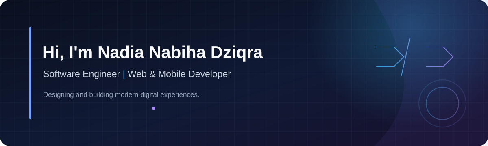



  
   
  

<h1 align="center">Hi, I'm Nadia Nabiha 👋</h1>

<strong>Developer · Technology Enthusiast</strong>

Learning, building, and turning ideas into software.

## About Me

I'm a developer with a strong interest in technology and application development. I enjoy learning by building and improving software projects.

- 🌱 Currently learning and strengthening my programming skills
- 🔭 Exploring software and application development
- 🤝 Interested in collaborating on thoughtful projects and learning with other developers

## Tech Interests

These are areas of interest, not a claim of professional proficiency. I’ll connect technologies to real projects as I add them to my public portfolio.

  
  
  
  
  
  

  
  
  

  
  
  
  
  

## Featured Work

I'm building and improving software projects as I grow my skills. Browse my [public repositories](https://github.com/nadianabiha?tab=repositories) to see what I'm working on.

> Pin your portfolio and `topic2-sudoku` repositories on GitHub to feature them here. Keep private project details private.

## Contribution Activity

Recent public activity, shown in a calm dark palette.

  

  
  

  

*Cards use publicly available GitHub activity and may not include private contributions. External services can occasionally be unavailable.*
## Achievements

  

## Connect

- GitHub: [@nadianabiha](https://github.com/nadianabiha)
- LinkedIn, Instagram, and email: add your official links when ready

   
  
  
Thanks for visiting my profile — have a great day! ✨

